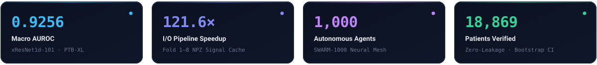

  <!-- Animated Hero Banner -->
  

  <!-- Animated Typing Tagline (Adaptive Dark / Light Theme) -->
  <picture>
    <source media="(prefers-color-scheme: dark)" srcset="https://readme-typing-svg.demolab.com?font=JetBrains+Mono&weight=500&size=15&duration=2800&pause=1500&color=38BDF8&center=true&vCenter=true&width=620&height=34&lines=Biomedical+AI+%C2%B7+Reduced-Lead+ECG+(PTB-XL);Trustworthy+AI+%C2%B7+Calibration+%26+Fairness;Autonomous+Multi-Agent+Swarm+(SWARM-1000)" />
    
  </picture>

  <!-- Live Visitor Counter & Unified Quick Links -->
  

    
    &nbsp;
    
    &nbsp;
    
  

---

### About

Computer & Software Engineering specialist and **AI / Deep Learning Researcher** building trustworthy clinical AI and autonomous multi-agent systems:

- **Biomedical AI & Signal Processing** — 1D Convolutional & Residual architectures (`xResNet1d-101`, `SimpleCNN1D`) for reduced-lead ECG classification on **PTB-XL**.
- **Trustworthy AI & Fairness** — Predictive uncertainty calibration (`ECE`, `Brier Score`, `MC Dropout`) and demographic fairness evaluation across age cohorts (`ΔECE`).
- **Multi-Agent Swarm Systems** — Coordinated autonomous agent architectures (**SWARM-1000**) for cross-code auditing, self-healing debugging, and live neural mesh visualization.

🇹🇷 Türkçe Özet

 

**Bilgisayar ve Yazılım Mühendisliği** alanında çalışan bir **Yapay Zeka ve Derin Öğrenme Araştırmacısıyım**:

- **Biyomedikal Yapay Zeka & Sinyal İşleme** — **PTB-XL** klinik EKG veri seti üzerinde derivasyon sayısı azaltılmış sınıflandırma için 1B derin ağ mimarileri (`xResNet1d-101`, `SimpleCNN1D`).
- **Güvenilir Yapay Zeka & Adalet** — `ECE`, `Brier Skoru` ve `MC Dropout` ile belirsizlik kalibrasyonu; yaş grupları arası algoritmik adalet (`ΔECE`) doğrulaması.
- **Çoklu Ajan Sistemleri** — Çapraz kod denetimi, otonom hata ayıklama ve gerçek zamanlı sinir ağı görselleştirmesi için **SWARM-1000** çoklu ajan mimarisi.

---

### Highlights

  

---

### Featured Projects

  
  

---

### Tech Stack

  <picture>
    <source media="(prefers-color-scheme: dark)" srcset="https://skillicons.dev/icons?i=python,pytorch,scikitlearn,js,html,css,git,github,linux,vscode&theme=dark&perline=10" />
    
  </picture>

 

  

