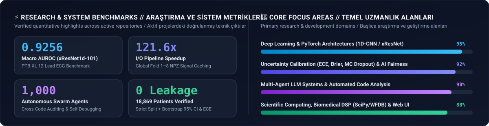
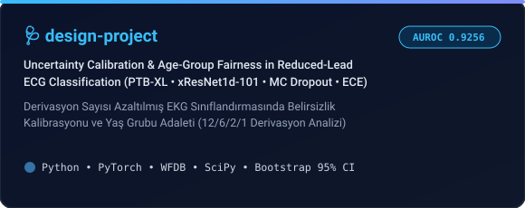

  <!-- Animated Custom SVG Hero Banner -->
  

   

  <!-- Status & Profile Badges -->
  

    
    
    
    
  

---

## 👨‍💻 About Me // Hakkımda

<table>
<tr>
<td width="50%" valign="top">

### 🇬🇧 English

Hello! I'm **Fatih Tunçel**, a **Computer & Software Engineering** specialist and **Artificial Intelligence & Deep Learning Researcher**.

My work bridges rigorous **deep learning research** with high-performance **software engineering**, focusing on trustworthy clinical AI and autonomous multi-agent architectures:

- 🩺 **Biomedical AI & Signal Processing:** Designing 1D Convolutional & Residual architectures (`xResNet1d-101`, `SimpleCNN1D`) on large-scale clinical datasets (**PTB-XL**) for reduced-lead ECG classification.
- 🎯 **Trustworthy AI (Uncertainty & Fairness):** Quantifying predictive confidence via **Expected Calibration Error (ECE)**, **Brier Score**, and **Monte Carlo (MC) Dropout**, while evaluating demographic fairness across age groups (`ΔECE`).
- ⚡ **Autonomous Multi-Agent Systems:** Building large-scale collaborative agent swarms (**SWARM-1000**) for automated cross-code auditing, self-healing debugging, and real-time neural mesh visualization.

</td>
<td width="50%" valign="top">

### 🇹🇷 Türkçe

Merhaba! Ben **Fatih Tunçel**, **Bilgisayar ve Yazılım Mühendisliği** alanında çalışan bir **Yapay Zeka ve Derin Öğrenme Araştırmacısıyım**.

Çalışmalarım; güvenilir klinik yapay zeka modelleri ve otonom çoklu ajan (multi-agent) mimarileri ekseninde **derin öğrenme araştırmaları** ile **yüksek performanslı yazılım mühendisliğini** birleştirmektedir:

- 🩺 **Biyomedikal Yapay Zeka & Sinyal İşleme:** Büyük ölçekli klinik veri setleri (**PTB-XL**) üzerinde derivasyon sayısı azaltılmış EKG sınıflandırması için 1B Evrişimli ve Artık ağ mimarileri (`xResNet1d-101`, `SimpleCNN1D`) geliştirilmesi.
- 🎯 **Güvenilir Yapay Zeka (Belirsizlik & Adalet):** **Beklenen Kalibrasyon Hatası (ECE)**, **Brier Skoru** ve **MC Dropout** ile model belirsizliğinin ölçülmesi; yaş grupları arası algoritmik adaletin (`ΔECE`) istatistiksel olarak doğrulanması.
- ⚡ **Otonom Çoklu Ajan Sistemleri:** Çapraz kod denetimi, otonom hata ayıklama ve gerçek zamanlı sinir ağı görselleştirmesi için 1.000 ajanlı işbirlikçi yapay zeka sistemlerinin (**SWARM-1000**) tasarlanması.

</td>
</tr>
</table>

---

## 📊 Research & Engineering Dashboard // Araştırma ve Mühendislik Vitrini

  

---

## 🚀 Featured Projects // Öne Çıkan Projeler

  
  

 

<table>
<tr>
<td width="50%" valign="top">

### 1. [🩺 Reduced-Lead ECG Classification: Uncertainty Calibration & Fairness (`design-project`)](https://github.com/fatihtuncel-tr/design-project)

> **EN:** Comprehensive deep learning pipeline on the **PTB-XL** clinical ECG dataset investigating how lead reduction (`12 → 6 → 2 → 1` leads) impacts diagnostic performance, predictive uncertainty calibration, and age-group fairness.
>
> **TR:** **PTB-XL** klinik EKG veri seti üzerinde derivasyon azaltımının (`12 → 6 → 2 → 1` derivasyon) tanı başarımı, belirsizlik kalibrasyonu ve yaş grubu adaleti üzerindeki etkisini inceleyen uçtan uca derin öğrenme araştırması.

- **Verified Benchmark:** `0.9256` Macro AUROC (`95% CI: [0.9185, 0.9326]`) with `xResNet1d-101` on Fold 10 test set, matching the Strodthoff et al. (`0.928`) literature standard within `-0.0024`.
- **Zero-Leakage Signal Pipeline:** Strict patient-disjoint splitting (`15,023` train / `1,942` val / `1,904` test patients), `0.5 Hz` zero-phase Butterworth filtering (`sosfiltfilt`), and `.npz` caching yielding a **`121.6x`** data loading speedup.
- **Calibration & Fairness Metrics:** Class-wise binary ECE (`M=15`), multi-label Brier score, patient-level bootstrap confidence intervals, and age-stratified disparity metrics (`ΔECE(75+ - <40)`).

</td>
<td width="50%" valign="top">

### 2. [⚡ SWARM-1000: AI Code Perfectizer & Autonomous Debugger (`swarm-1000-code-perfectizer`)](https://github.com/fatihtuncel-tr/swarm-1000-code-perfectizer)

> **EN:** Multi-agent autonomous code inspection, error debugging, and refactoring platform powered by a coordinated swarm architecture with an interactive HTML5 neural mesh visualization interface.
>
> **TR:** Koordineli çoklu ajan mimarisi ve etkileşimli HTML5 sinir ağı görselleştirme arayüzü ile güçlendirilmiş; çapraz kod denetimi, otonom hata ayıklama ve yeniden yapılandırma (refactoring) platformu.

- **Swarm Intelligence Engine:** Orchestrates specialized agent roles across syntax auditing, security vulnerability scanning, complexity reduction, and automated patch synthesis (`real_super_ai.py`, `agent_swarm.js`).
- **Interactive Neural Mesh UI:** Real-time canvas network (`network_canvas.js`) visualizing agent communication topologies, consensus formation, and live diagnostic streams.
- **Full-Stack Architecture:** Lightweight Python backend (`app.py`) paired with a responsive, zero-dependency modern JavaScript frontend (`main.js`, `academy.js`).

</td>
</tr>
</table>

---

## 🛠️ Tech Stack & Arsenal // Teknoloji Yığını ve Araçlar

  <!-- Skill Icons Visual Bar -->
  

    
  

| Category / Kategori | Technologies & Frameworks / Teknolojiler ve Kütüphaneler |
| :--- | :--- |
| **🧠 Deep Learning & AI** *(Derin Öğrenme & YZ)* |     -0284C7?style=flat-square) |
| **📊 Scientific & Biomedical DSP** *(Bilimsel Hesaplama & Sinyal İşleme)* |   -8CAAE6?style=flat-square&logo=scipy&logoColor=white) -059669?style=flat-square)  |
| **💻 Languages & Web Systems** *(Programlama Dilleri & Web)* |  -F7DF1E?style=flat-square&logo=javascript&logoColor=black)    |
| **⚙️ Engineering & Workflow** *(Mühendislik & Araçlar)* |     |

---

## 📫 Connect & Collaboration // İletişim ve İşbirliği

- 🌐 **GitHub Portfolio:** [github.com/fatihtuncel-tr](https://github.com/fatihtuncel-tr)
- 📧 **Email / E-posta:** [fatih1975eses@gmail.com](mailto:fatih1975eses@gmail.com)
- 🔬 **Research Interests / Araştırma Alanları:** Deep Learning, Biomedical Signal Processing (ECG), Uncertainty Quantification, Algorithmic Fairness, Multi-Agent AI Systems.

   
  

